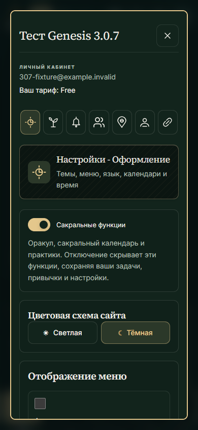
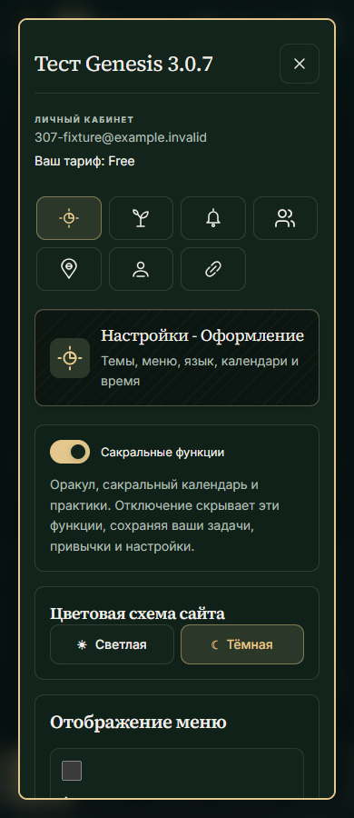
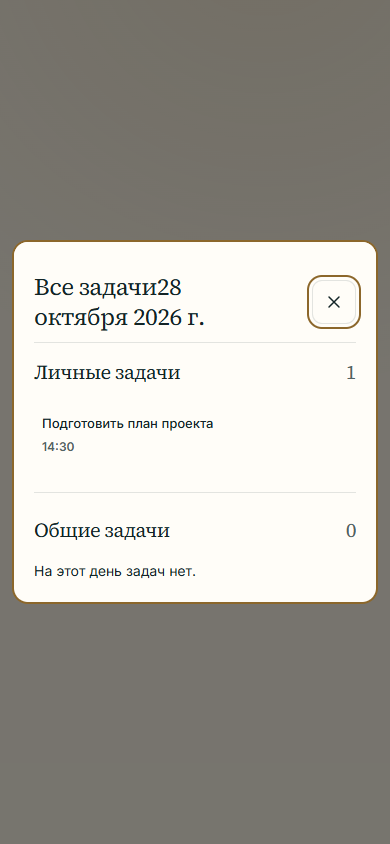
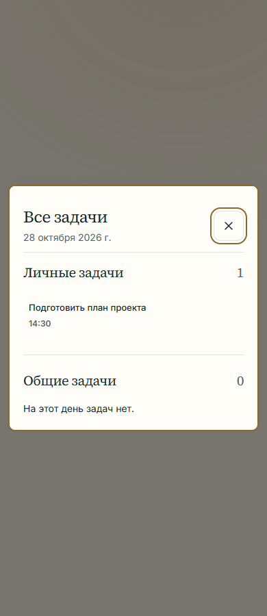
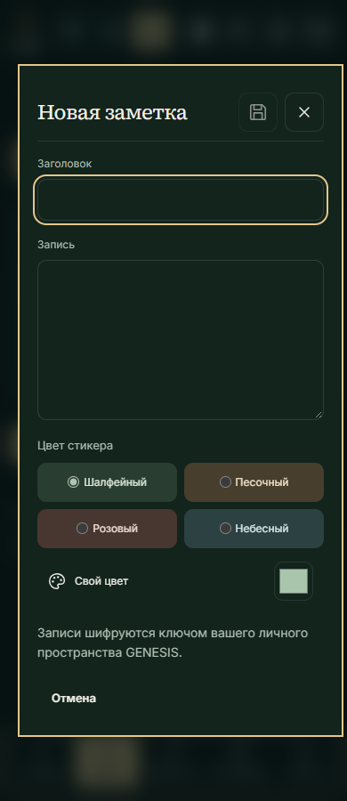
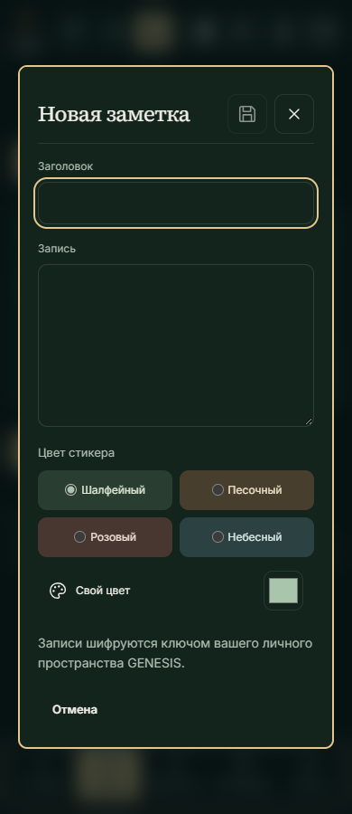

# GENESIS Tasker 3.0.7 — повторная проверка согласованности дизайна

28 октября 2026. База проверки: `9b35a619f0cd6064c185d78b3ef9b7fcdfb9acaf`, ветка `codex/ui-consistency-audit`.

**Статус: исправления подготовлены для просмотра до деплоя.** Эта ветка не слита в master. Production остаётся на ранее опубликованном 3.0.7; новые APK/AAB, установка на телефон и публикация в Play не выполнялись. `GENESIS_DEPLOY_ANDROID=false` подтверждён через GitHub.

## Основа и метод

Сохранён образец 3.0.5 / STANDART: существующие зелёные и золотые акценты, светлая и тёмная схемы, изображения, иконки, функции и данные. Проверка началась с общего каркаса и одного окна задач дня, затем проверены остальные основные экраны и общие компоненты. Новых UI-библиотек нет.

Браузерная проверка использует настоящий `GenesisCalendar`, штатные обработчики диалогов, реальные компоненты общих проектов и привычек, локальный PHP API и синтетический аккаунт. Пользовательские production-данные не читались и не менялись. Исходный OneDrive checkout с пользовательскими изменениями Фюзиса не затронут.

Различаются три вида доказательств: отображение и действия в Chromium, проверка исходников, автоматические проверки. Проверка исходника Android не считается проверкой приложения на телефоне.

## Подтверждённые расхождения и исправления

| ID | Приоритет | Подтверждение до исправления | Результат |
| --- | --- | --- | --- |
| DC-01 | P2 | Общий заголовок превращал заголовок и вложенную дату в `Все задачи28 октября 2026 г.` | Явный подзаголовок даты сохраняется отдельной строкой. Общий механизм продолжает использовать исходные обработчики сохранения и закрытия. |
| DC-02 | P3 | Окно задач дня имело радиус 16px, строка задачи — 8px, при согласованном обычном радиусе 10px | Окно и строки используют общий токен радиуса; измерено 10px. |
| DC-03 | P2 | Семь кнопок разделов настроек на 390px сжимались до 39.1px, ниже нормы 44px | На ширинах до 480px — сетка из четырёх колонок; кнопки не сжимаются, все семь остаются видимыми. При 360px цель 64×48px. На широком экране сохранён один ряд. |
| DC-04 | P2 | Цветовые образцы редактора привычки на 1440px были 36×36px; на мобильном уже 44×44px | Единая адаптивная сетка и образцы 44×44px на всех проверенных ширинах. Проверен выбор цвета. |
| DC-05 | P3 | Действие восстановления сакральной привычки импортировало непосредственно Material TextButton, обходя STANDART-обёртку | Используется общий native TextButton с высотой не менее 48dp и формой 10dp. Подтверждено исходником и компиляцией, визуально на устройстве не проверено. |
| DC-06 | P3 | Native редактор привычки имел собственную шапку и русскую строку contentDescription крестика | Используется общий GenesisDialogHeader: одинаковый крестик без рамки справа, локализованное имя, семантика заголовка и 48dp. Блокировка кнопки при сохранении сохранена. |
| DC-07 | P2 | Редактор дневника имел прямоугольную рамку и ширину относительно viewport, не учитывая отступы подложки: при 390px поля слева/справа 20px/4px | Подключён общий стиль диалога, ширина ограничена родительским контейнером. Все четыре ширины и обе темы: симметричные поля, радиус 10px, без горизонтального переполнения. |

P0/P1 в проверенных сценариях не выявлены. Это не заключение об отсутствии ошибок во всех возможных состояниях и на всех устройствах.

## Снимки до и после

Все снимки ниже сделаны с синтетическими данными. Разница высоты viewport у первой пары не меняет измеренную ширину кнопок: обе проверки выполнены при 390px.

| Настройки — до | Настройки — после |
| --- | --- |
|  |  |

| Задачи дня — до | Задачи дня — после |
| --- | --- |
|  |  |

| Дневник — до | Дневник — после |
| --- | --- |
|  |  |

Полная локальная доказательная база: `output/playwright/audit-*.png`, журналы и измерения в `output/ui-audit-2026-10-28/`. Они остаются ignored. Шесть приведённых снимков включены в Git, чтобы отчёт можно было просмотреть в PR.

## Матрица покрытия

| Область | Выполнено | Предел проверки |
| --- | --- | --- |
| Общая шапка, навигация, Сегодня, личные дела, привычки, месяц, год, Стойхейон, Теокиклос | До/после: 7 экранов × 4 ширины × 2 темы = 56 состояний в каждом проходе; измерена ширина документа | Синтетические данные; не все индивидуальные пользовательские настройки |
| Сакральный и лунный календари | Дополнительные месяц/год × 4 ширины × 2 темы = 32 состояния | Не полный перебор годов, регионов и астрономических событий |
| Общие проекты | Доски, список, календарь, Гант × 4 ширины × 2 темы = 32 состояния; задачи на доске и в хаос-боксе проекта | Длинные производственные проекты, все роли участников и жесты перетаскивания здесь не перебирались |
| Настройки, редактор привычки, окно задач дня | Проверка рамок окна, горизонтального содержимого, размеров изменённых действий, выбора цвета; обе темы и все четыре ширины | Системные окна Google и ОС не имитировались |
| Дневник | Редактор заметки × 4 ширины × 2 темы = 8 состояний; отдельно открытие дневника, карты и панели уведомлений; в редакторе привычки — блокировка пустого названия и сохранение через общую шапку | Полный обмен сообщениями и синхронизация документов между устройствами не проверялись вручную |
| Языки | Общий i18n-аудит всех поддерживаемых языков; визуальная проверка редактора EN/DE/EL/JA при 360/1440px в обеих темах | Не вычитка каждого текста носителем языка, не визуальный перебор всех экранов на всех языках |
| Поиск, редакторы задач/проектов, майндмепы, дневник, сообщения, отчёты/планирование, восстановление/данные привычек | Инвентаризация исходников, общие компоненты и автоматические регрессии; дополнительные локальные проверки основных входов | Не полная ручная проверка каждого вложенного окна и сетевого отказа |
| Android | Инвентаризация 209 файлов UI; 37 файлов с custom Dialog и 46 с AlertDialog; просмотр общих окон и исключений, компиляция и JVM-тесты | Без новых APK/AAB и без runtime-проверки исправленного кода на Realme |
| Фюзис, администрирование и реклама | Проверка общих стилей/контролов в исходниках; существующие автоматические тесты | Runtime ограничен правами синтетического аккаунта; закрытые админские и персональные состояния не проверены |
| Публичная главная и четыре документа | Проверены сборочным валидатором: читаются без JavaScript, ссылки на .com и Google-only | Отдельный визуальный перебор публичных страниц в этом проходе не выполнялся |

Во всех проверенных основных экранах и видах общего проекта ширина документа соответствует viewport. Внутреннее горизонтальное прокручивание досок, Ганта и карт сохраняется там, где оно необходимо. Годовые месяцы используют существующий `content-visibility:auto`: пустые дальние области на полном скриншоте до прокрутки не приравнивались к отсутствию данных.

## Анализ автоматического детектора

Один проход Impeccable по `app` и native UI. Получено 2382 сигнала, из них 2340 справочных о цветах, размерах и радиусах и 42 предупреждения. Это не 2382 подтверждённые ошибки интерфейса. Проверены классы сигналов и основные места каскада:

- Существующие цвета месяцев, практик, пользовательских проектов и иллюстраций несут смысл и не заменялись базовым зелёным.
- Старые правила Arial/Inter перекрываются текущим STANDART-каскадом; наличие объявления шрифта не доказывает неправильный вычисленный шрифт.
- Круглые переключатели, маркеры календаря и композиции Оракула не переводились в обычные прямоугольные карточки по числу радиуса.
- Изменение ширины полос прогресса и сохранённые цветовые маркеры не удалялись ради формального обнуления детектора.
- Сжатые действия и склеенный подзаголовок подтверждены браузером и исправлены; результаты ручной проверки приоритетнее количества сигналов.

Native Kotlin не имеет полноценной визуальной проверки этим web-детектором; для Android использованы отдельная инвентаризация и Gradle.

## Проверки кода

- `pnpm install --frozen-lockfile` — успешно, lockfile не изменён.
- `pnpm lint` — 0 ошибок, 2 существующих предупреждения Next img в компонентах майндмепов.
- `pnpm test` — 743 теста, 743 passed, 0 failed; включает i18n-аудит и сборку.
- `pnpm build:beget` — успешно; 116 обязательных entry-ассетов и 402 визуальных ассета; крупнейший JS chunk 349999 байт при лимите 350000.
- `:app:compileDebugKotlin :app:testDebugUnitTest --offline` — успешно; 855 случаев, 8 штатно skipped, 847 выполнено, ошибок/падений 0.
- `git diff --check` — успешно.

## Непроверенные состояния перед Android-выпуском

На исправленном native коде ещё нужны Realme/эмулятор: светлая/тёмная темы, экранная клавиатура и изменение ориентации, TalkBack, увеличенный системный шрифт, прокрутка длинных диалогов, жесты Ганта/календаря/майндмепов и сетевые ошибки с настоящими разрешениями. Статические и JVM-проверки этого не заменяют.

Полный ручной аудит комбинаций всех языков, ролей, больших объёмов данных и отказов не заявляется. Это отдельная остающаяся область проверки, а не основание считать её пройденной.

## Публикация и восстановление

Ни схема БД, ни API-контракты, ни подпись Android, ни настройка CI/CD не изменялись. SSH не использовался. До отдельного запуска согласованного деплоя изменения остаются в рабочей ветке/PR. При последующей публикации применяется существующий `deploy.yml`; откат кода — обычный git revert, восстановления БД эта правка не требует.
